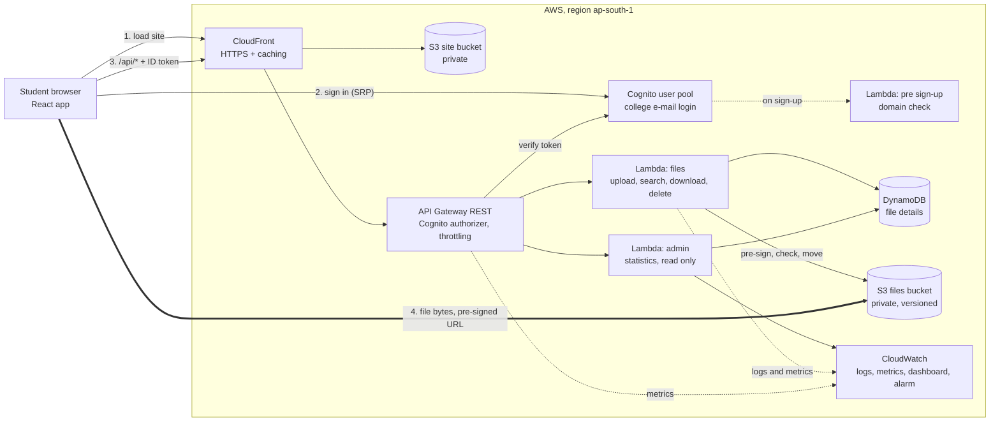

# CloudDrop architecture

## 1. The idea in one paragraph

Every part of CloudDrop is a managed AWS service that runs only when someone
uses it. The website is static files in S3, delivered by CloudFront. Login is
Amazon Cognito. Each button press calls a REST endpoint on API Gateway, which
runs a short Python function on AWS Lambda. File details live in DynamoDB. The
files themselves live in S3 and travel directly between the browser and S3.
There is no virtual machine to patch, scale or pay for at 3 a.m.

## 2. Diagram



## 3. Components

| Component | AWS service | What it does here |
|---|---|---|
| Website | S3 + CloudFront | Static React build in a private bucket. Only CloudFront can read it (origin access control). HTTPS everywhere. |
| Login | Cognito user pool | Sign-up, e-mail verification, sign-in, password reset. Issues 60-minute tokens. The app never stores a password. |
| Sign-up rule | Lambda (`presignup`) | Refuses any e-mail that is not exactly `name@thapar.edu`. |
| API | API Gateway (REST) | Routes `/api/*`. Checks the Cognito token before Lambda runs. Throttles at 25 requests/second (burst 50). |
| Logic | Lambda (`files`) | Validates input, writes details, makes pre-signed URLs, confirms uploads, counts downloads, deletes. |
| Admin | Lambda (`admin`) | Totals and breakdowns from DynamoDB plus API and Lambda numbers from CloudWatch. Read-only permissions. |
| File details | DynamoDB | One item per file. On-demand billing. Three indexes for listing. |
| Files | S3 | Private, encrypted, versioned bucket with lifecycle rules. |
| Monitoring | CloudWatch | Logs (14-day retention), a dashboard, an alarm on API 5xx errors, custom upload/download metrics. |

One CloudFront distribution serves both the site and `/api/*`. The browser
therefore sees a single origin, and the API needs no CORS setup.

## 4. API

Every route needs a valid Cognito ID token in the `Authorization` header (the token itself, no `Bearer` prefix).

| Method and path | What it does |
|---|---|
| `GET /api/me` | Who am I, am I an admin, and what are the upload rules |
| `GET /api/files` | List files, newest first. Filters: `subject`, `semester`, `type`, `q`, `mine`. Paging: `limit`, `cursor` |
| `POST /api/files` | Start an upload: checks the details, returns a pre-signed upload form |
| `POST /api/files/{id}/complete` | Confirm the upload reached S3; the file becomes visible |
| `GET /api/files/{id}` | One file's details |
| `GET /api/files/{id}/download` | Adds 1 to the download count, returns a 5-minute download link |
| `DELETE /api/files/{id}` | Delete (uploader or admin only) |
| `GET /api/admin/stats` | Dashboard numbers (admins only) |

Errors look like `{"error": {"code": "validation_error", "message": "Semester must be a whole number from 1 to 8."}}`.

## 5. How an upload works

```
Browser                      API Gateway + Lambda                 DynamoDB            S3
   │ POST /api/files  ───────────────>│ validate details              │               │
   │                                  │ put item, status PENDING ────>│               │
   │ <── upload form (URL + fields) ──│ pre-sign POST for pending/<id>                │
   │                                                                                  │
   │ POST file straight to S3  ══════════════════════════════════════════════════════>│
   │                                                                                  │
   │ POST /api/files/<id>/complete ──>│ does pending/<id> exist? how big? ───────────>│
   │                                  │ copy to files/<id> ──────────────────────────>│
   │                                  │ set status ACTIVE, add index keys ─>│         │
   │ <── file details, ACTIVE ────────│ delete pending/<id> ─────────────────────────>│
```

The pending copy is deleted last, so if any step fails the browser can simply
confirm again.

Why two steps: a file is not listed until S3 really has it. If the browser
closes mid-upload, nothing is left behind: DynamoDB's TTL removes the PENDING
item after an hour and an S3 lifecycle rule empties `pending/` daily.

Why pre-signed URLs: Lambda has a 6 MB request limit and bills by time. Sending
a 25 MB file through it would be slow, costly and impossible. With a
pre-signed URL the bytes go directly to S3 and Lambda only handles small JSON.

## 6. Data model

One DynamoDB table, key `fileId`.

| Attribute | Example | Note |
|---|---|---|
| `fileId` | `cd97481102c9…` | Random 32-character id |
| `status` | `PENDING` / `ACTIVE` | |
| `title`, `fileName`, `contentType`, `size` | | `contentType` is taken from the extension, never from the client |
| `subjectCode`, `semester`, `resourceType`, `tags`, `description` | `UCS531`, `5`, `notes` | |
| `uploaderId`, `uploaderEmail`, `uploaderName` | | From the verified token |
| `createdAt` | `2026-11-20T10:00:01.000000Z` | Sort key of every index |
| `downloadCount` | `12` | Increased atomically with `ADD` |
| `searchText` | lower-cased title + file name + subject + tags + uploader | For text search |
| `s3Key` | `files/<fileId>` | |
| `expiresAt` | epoch seconds | TTL; only on PENDING items |
| `gsiAll`, `gsiSubject`, `gsiUploader` | | Index keys; written only when ACTIVE |

| Index | Key | Used for |
|---|---|---|
| `byRecent` | `gsiAll` + `createdAt` | "Everything, newest first", admin statistics |
| `bySubject` | `gsiSubject` + `createdAt` | Filter by subject code |
| `byUploader` | `gsiUploader` + `createdAt` | "My uploads" |

The index keys are added only when an upload is confirmed. A PENDING item is in
no index, so it can never appear in a listing (a "sparse index").

Other filters (semester, type, text) are applied by DynamoDB as a filter on
the index query. This reads more items than it returns, which is fine for a
campus (thousands of files). For millions of files the next step would be
Amazon OpenSearch.

## 7. Security

| Risk | What stops it |
|---|---|
| Outsiders signing up | Pre sign-up Lambda checks the domain; Cognito e-mails a code to prove the address |
| Calling the API without logging in | API Gateway's Cognito authorizer rejects the request before Lambda runs |
| Pretending to be another user | Identity comes only from the verified token, never from the request body |
| Changing your e-mail after sign-up to dodge the domain rule | Cognito applies a new e-mail only after it is verified; Lambda also refuses any token whose e-mail is unverified or off-domain |
| Someone registering your address before you | The sign-up screen lets the real owner confirm with a fresh code and then reset the password |
| A student deleting someone else's file | Lambda checks uploader or `admins` group |
| Students opening the dashboard | Lambda checks the `admins` group; the admin Lambda has read-only permissions anyway |
| Uploading a harmful file type | Extension allow-list; content type set by the server; no `.html`, `.svg`, `.js`, `.exe` |
| Uploading a huge file | The pre-signed form is valid only for the exact size the API approved; Lambda checks the real size again on confirm |
| One account filling the bucket | Per-user file limit (default 200), checked when an upload starts |
| Reading files without the app | Bucket blocks all public access; links are pre-signed and expire in 5 minutes |
| One function doing too much if compromised | Each Lambda has its own IAM role with only the actions and resources it uses |
| Eavesdropping | HTTPS only; both buckets refuse plain HTTP; data encrypted at rest |
| Accidental delete or overwrite | S3 versioning keeps old versions for 30 days; DynamoDB point-in-time recovery is on |
| A flood of requests | API Gateway throttling |

The mock AWS used in tests ignores IAM, so a separate test
(`backend/tests/test_iam.py`) records every AWS call the functions make and
checks the template's policy allows each one.

## 8. Cost and storage management

- **Compute:** Lambda and API Gateway bill per request. Zero requests, zero cost.
- **Database:** DynamoDB on-demand, billed per read and write.
- **Storage lifecycle:** `pending/` expires after 1 day; stored files move to
  the cheaper Infrequent Access class after 90 days; old versions are removed
  after 30 days.
- **Logs:** kept 14 days.

## 9. Monitoring

- CloudWatch dashboard `<stack>-overview`: API requests and errors, latency,
  Lambda invocations/errors/throttles/concurrency, uploads and downloads,
  DynamoDB capacity used.
- Alarm `<stack>-api-5xx`: 5 or more server errors in 5 minutes.
- Custom metrics `FilesUploaded`, `FilesDownloaded`, `FilesDeleted` are written
  with the CloudWatch Embedded Metric Format: one JSON log line, no API call.
- The in-app admin dashboard shows the same API and Lambda numbers for the last
  24 hours, plus library statistics.

## 10. Syllabus topics covered

| Syllabus topic | Where it shows up |
|---|---|
| Cloud service models (IaaS / PaaS / SaaS) | CloudDrop itself is SaaS for students. It is built on PaaS/FaaS services (Lambda, API Gateway, DynamoDB, Cognito). The EC2 comparison in `SERVERLESS_VS_EC2.md` is the IaaS alternative. |
| Serverless and Function-as-a-Service | Three Lambda functions, event-driven, stateless |
| Cloud object storage | S3: versioning, lifecycle, encryption, pre-signed URLs, static hosting |
| NoSQL database as a service | DynamoDB: on-demand, global secondary indexes, TTL, atomic counters |
| Identity and Access Management | Cognito for users; least-privilege IAM roles between services; bucket policies |
| Content Delivery Networks | CloudFront: HTTPS, edge caching, origin access control, two origins |
| Cloud monitoring and elasticity | CloudWatch logs/metrics/dashboard/alarm; automatic scaling from zero; load test |

## 11. Known limits

- Text search is a DynamoDB filter, not a search engine. Good for thousands of
  files, not millions.
- Admin statistics read every active item on each refresh. Same scale limit.
- The per-user file limit counts confirmed files. Unconfirmed uploads are not
  counted; they are cleaned up within a day. API throttling is shared by all
  users, not per user.
- Sign-ups that were never confirmed stay in Cognito. The owner can still claim
  the address (see Security); a scheduled clean-up would be tidier.
- Files are not virus-scanned. A `.zip` or `.docx` can carry anything.
- Cognito's built-in e-mail sender is limited to about 50 e-mails a day. For a
  real launch, connect Amazon SES.
- If the browser uploads a file but never confirms it, the file is removed
  after a day rather than recovered.
