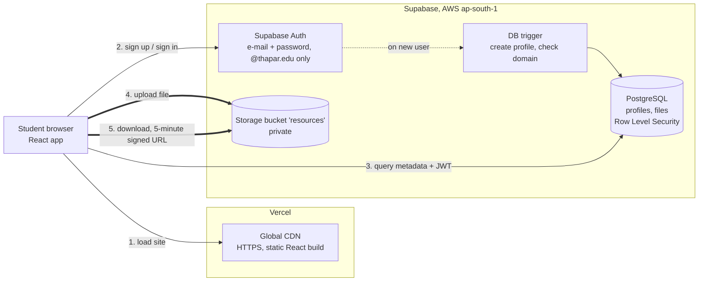

# CloudDrop live deployment (Vercel + Supabase)

Live site: https://clouddrop-five.vercel.app

The AWS SAM stack in `infra/template.yaml` is the primary design (see
[ARCHITECTURE.md](ARCHITECTURE.md)). While AWS account verification was
pending, the same React app was deployed on managed cloud platforms so a
working version is always available. Supabase's project runs in AWS region
`ap-south-1` (Mumbai).

## Diagram



## Components

| Concern | AWS design | Live deployment |
|---|---|---|
| Static hosting + CDN | S3 + CloudFront | Vercel |
| Login | Cognito user pool + pre sign-up Lambda | Supabase Auth + database trigger |
| File metadata | DynamoDB via Lambda | Supabase PostgreSQL (`profiles`, `files`) |
| File storage | Private S3, pre-signed URLs | Private Supabase Storage, signed URLs |
| Access control | API Gateway Cognito authorizer + IAM | Row Level Security policies |

## Security

- Row Level Security on every table: only signed-in users can read; users can
  insert and delete only their own rows.
- The `resources` bucket is private. Downloads use signed URLs valid for 300 s.
- Sign-up is limited to `@thapar.edu` addresses (checked in the browser and by
  a database trigger).
- Only the publishable (anon) key is shipped to the browser; it is supplied to
  the Vercel build as `VITE_SUPABASE_URL` and `VITE_SUPABASE_PUBLISHABLE_KEY`.
- The Supabase security advisor reported no warnings.

## How the frontend chooses a backend

`frontend/src/lib/config.js`: if the Supabase build variables are set, the app
runs in `supabase` mode (`frontend/src/lib/auth/supabase.js`,
`frontend/src/lib/api.js`). Otherwise it loads `/config.json` and runs in
`local` or `cognito` (AWS) mode.

## Required Supabase setting

Authentication → URL Configuration:

| Field | Value |
|---|---|
| Site URL | `https://clouddrop-five.vercel.app` |
| Redirect URLs | `https://clouddrop-five.vercel.app/**` |

## Download counter (one-time SQL)

Students may only update their own rows, so the download counter is bumped by a
small `security definer` function. Run
[`supabase/increment_download.sql`](../supabase/increment_download.sql) once in
the Supabase SQL Editor. Without it downloads still work; the count just stays put.

## Library features

- Search by title, tag, file name or uploader; filter by subject, semester, type.
- Popular-subject shortcuts and live totals (files, subjects, downloads).
- Sort by newest, most downloaded, or title.
- Filters are kept in the address (`#/library?subject=UCS531`), so a search can be shared.
- PDFs and images open in the browser through a 5-minute signed URL; other files download.

## Saved files, reports, activity log, live updates (one-time SQL)

Run [`supabase/features.sql`](../supabase/features.sql) once in the SQL Editor
(it also installs the download counter, so `increment_download.sql` is then not needed).
It adds `bookmarks`, `reports` and `activity` tables with Row Level Security,
triggers that write the activity log, and adds `files` to the Realtime publication.
Until it is run the app hides these features.

To see the Dashboard, make your account an admin:

```sql
update public.profiles set is_admin = true where email = 'your.name@thapar.edu';
```
